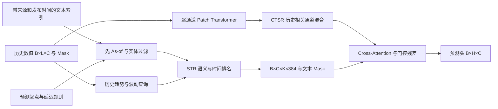

# 模型与实现对应

Stage 2 位于独立的 `pivot_stage2/`，不依赖旧 Time-MMD 文本管线。旧模型和实验结果保留。

## Dataset 与冻结编码

`data.py` 输出 `[L,C]` x_num/x_mask、`[H,C]` y/y_mask、origin_time、channel_ids、`[C,K,384]` text_embeddings/text_mask 和逐条 text_metadata。DataLoader 生成 batch 维。真实 y 的缺失只用安全占位参与存储，损失和指标依据 y_mask 排除，保存的真实值数组在缺失处为 NaN 并带 Mask。

`encoding.py` 使用冻结 all-MiniLM-L6-v2，commit `1110a243fdf4706b3f48f1d95db1a4f5529b4d41`，Transformers AutoModel/Tokenizer、attention-mask mean pooling、L2 normalize、最长 128 tokens、384 维。模型 eval 且冻结，文档和 88×6 个解释性查询离线缓存，无付费 API。截断发生在 2048 字符日文档和 tokenizer 的 128 tokens 两处。保留了 train-only TF-IDF 后备接口及旧缓存，但当前默认已成功使用 MiniLM。

## Backbone 与 CTSR

`models.py:PatchEncoder` 在每个通道共享参数，将历史数值与缺失 Mask 拼成 patch 特征，加入位置参数，经过轻量 Transformer，汇成 `[B,C,D]`。左侧补齐确保最后一个历史点进入 patch；不读取预测段。

`CTSR.select` 对历史有效值作通道中心化，计算 Mask 处理后的中心化内积相似度与 FFT 幅度余弦相似度，各占 0.5。缺失日用零中心值表示，因此这是 Mask 处理的近似相关度，并非逐对共同有效日重新拟合的 Pearson。至少两个有效点才允许入选，排除自身；并列按原通道索引稳定排序。Top-K 邻居表示取均值后线性变换并残差加入。CTSR 选择和混合的是数值通道表示；文本默认仍按各自股票实体过滤。该混合改变后续跨模态注意力的数值查询。

## STR

`retrieval.py` 先计算 `available_at <= origin` 且落在最近 30 天内的实体候选，再访问这些候选的 embedding 并评分。不能先对完整索引排序再过滤。

数值查询只依赖历史原单位收益：均值按 ±1bp 分成下降/平稳/上升，标准差按 2% 分成低/高波动，共 6 个预编码查询。语义分数为 embedding 点积；时间项为 `0.2 * exp(-age_days/3)`，默认合并后取 Top-4。latest 只按可用时间，random 使用由 seed/origin/entity 绑定的局部 RNG；mean 池化所有合法候选，不局限于最新 K 条。shuffled 在同一起点交换通道关联。策略、源索引与运行数据哈希写入运行绑定和追踪。

检索返回文档 ID、源、发行/可用/预测时间、分数、实体、政策与历史查询统计。验证“已知接收时间”需要显式来源标记，不能把当前下载时间填作 received_at。

## Fusion 与输出

数值 `[B,C,D]` 为 Query，投影后的文本 `[B,C,K,D]` 为 Key/Value，逐通道 Cross-Attention。门控 `sigmoid(W[numeric,update])` 控制残差更新，再用共享线性头输出 `[B,H,C]`。没有合法文本的行直接返回原数值表示，避免全 Mask softmax 和虚假零向量增益；测试覆盖填充区 NaN、整行无文本、缺失数值通道与 batch=1。

DLinear 将窗口分成移动平均趋势和残差两路，分别线性预测，另输入 Mask 分支。PatchTST 风格基线是上述轻量共享通道 patch 编码器关闭 CTSR/文本，**不是声称复现官方 PatchTST 的全部训练配方**。PIVOT backbone 保留 CTSR、关闭文本。StockNet naive 输出严格原单位零收益，天气 naive 使用当前窗口最后可得值的 persistence。

`external.py` 另提供 GFS 数值控制接口：只允许相同合法 Run 的 forecast_kind 预报记录、精确 valid_time 匹配、相同可用政策，禁止把未来观测传入；没有外部值时是数值骨干的恒等退化。这部分仅有合成接口测试，**没有真实 GFS 模板文本或正式配置准入**，不把它算作成功外部预报实验。
