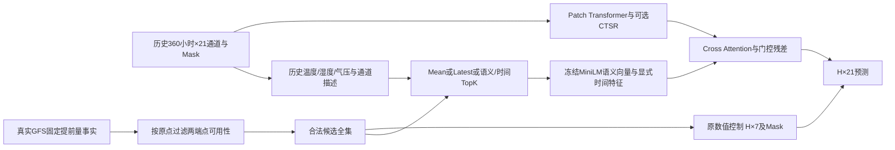

# v2 模型、文本与公平性

v2 独立模块复用 v1 有效的 PatchEncoder、CTSR、Fusion 和 Mask 指标，未改写 v1。完整训练器位于 pivot_stage2_v2/train.py，Dataset 和外部数值控制位于 data.py/models.py。

原数值控制和文本增强是不同模型分支，不把它们同时提供给 Full PIVOT。Dataset 统一输出 x_num/x_mask、y/y_mask、UTC origin/history_end/first_target、文本向量/Mask/来源，以及 gfs_num/gfs_mask。模型特征显式白名单不含 y。

数值控制从合法预报全集构造 [H,7] 的温度矩阵和 Mask，按 Jena 训练温度 scaler 归一化，经线性投影加到同一数值骨干预测。它使用的是共同的 API 派生预报值，不声称是未经处理的全球 GRIB。没有合法预报时投影输入全零，严格退化为数值骨干。

模板英文正文只陈述源温度和名义提前量；实际 UTC 有效时刻加在完整文档及结构化 metadata 中，不生成源数值不支持的天气结论。冻结 MiniLM 对去重后的天气事实正文编码，绝对日期单独存储和过滤。相同事实正文在不同时刻共享向量，所有文档仍有不同的时间/ID/来源。融合另学习三个显式时间特征：相对 origin 的 valid hours、可用时间的新近性、名义提前量（均/168），避免依赖语言模型理解日期字符串。这一投影参与训练，MiniLM保持冻结。

检索查询不使用股票收益模板。21个原始通道均按源别名解析到对应气象描述，结合历史窗口有效温度均值（<5/5—20/>20°C）、湿度（<60/≥60%）与气压（<1000/≥1000mbar）构成12种解释性天气查询；只使用历史原始单位，不读取未来目标。全球天气候选可被全部相关通道访问，由语义排名区分，保留21个输出通道。

时间项为0.2×exp(-age_hours/24)，默认Top-K=4。latest按可用时间，random用seed/origin/channel确定的合法池局部随机数，mean池化所有合法事实。CTSR只用历史中心化相关度/频域幅度，排除自身、缺失通道，稳定处理并列。文本投影、Cross-Attention和门控残差接入同一数值表示；全无文本的行严格为数值表示，填充区和时间特征均受Mask控制。

所有方法共享同一H的数值起点、输入、真实标签、Mask和外部信息权限。Raw 和文本可访问的候选全集完全相同；检索只从此全集取K，mean使用全集，文本组没有更多或更晚的源预报。检索减少事实数量是算法的既定差异，未为文本组单独换更准确的Run或提供未来观测。

MiniLM的发布时间晚于历史任务，属于所有文本方法共享的现代离线先验，不是2014/2021年真实部署还原；未知预训练语料重合风险需披露。参数数目报告注册参数，关闭组件可仍保留权重，不代表活跃计算量完全匹配。模板语义、显式时序特征与强外部预报源的贡献必须分别由原数值控制、文本基线和消融判断，目前没有正式性能证据。
